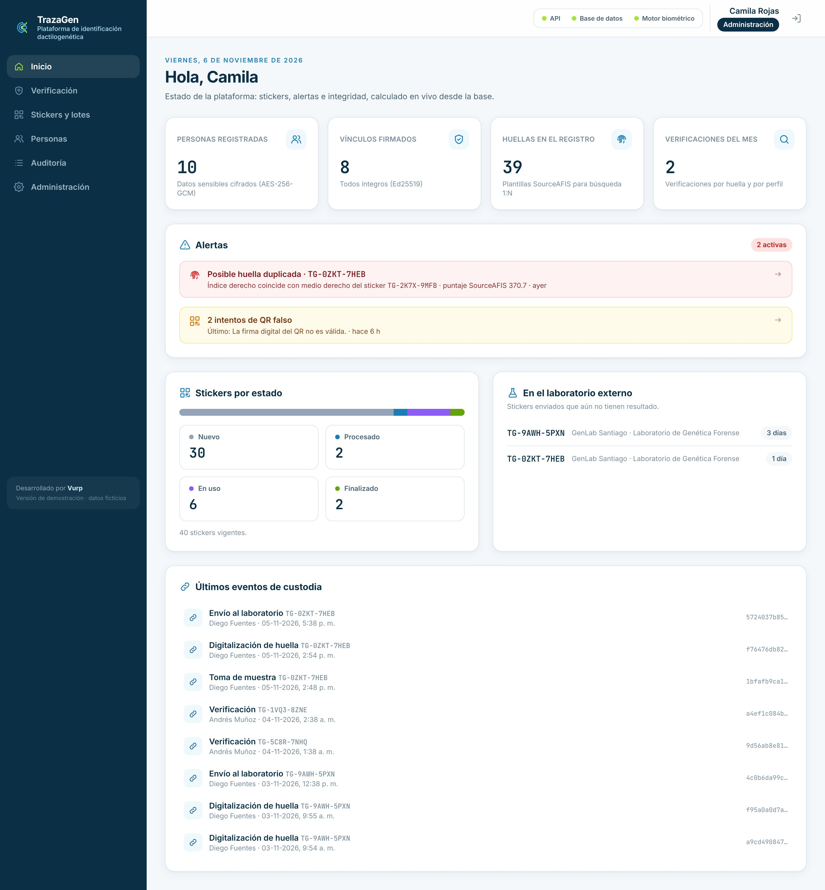

# TrazaGen · Plataforma de identificación dactilogenética

**TrazaGen** une, en un solo registro verificable, las **huellas dactilares** y el **perfil genético (STR)** de una persona, obtenidos en una sola toma con un sticker adhesivo patentado:

- La persona apoya los dedos con grafito sobre el sticker (5 o 10 casillas según el país). La huella se digitaliza con escáner o foto.
- Las células de la piel que quedan en el adhesivo van a un **laboratorio externo**, que extrae el ADN y devuelve el perfil STR (CODIS CMF XML o planilla de genotipos). TrazaGen no registra los procesos internos del laboratorio: registra a quién se envió el sticker y recibe el resultado.
- Cada sticker sale de fábrica con un **QR firmado** y sin datos personales. **El código del sticker es el ID dactilogenético** de la persona.
- La «fusión» entre huella y ADN es un **vínculo firmado con Ed25519** que une sticker, persona, plantillas de huella y perfil genético. No se calcula ningún hash a partir de los datos biológicos: se firma el registro y cualquier alteración posterior se detecta.

Esta es una **demo funcional**: todo lo que se ve funciona de verdad. Lectura real de archivos de laboratorio, búsqueda real de huellas con SourceAFIS, firmas criptográficas reales y una cadena de custodia que no se puede alterar ni desde la base de datos. Los datos personales y genéticos son ficticios; las imágenes de huellas son de la base pública **FVC2002**.

Desarrollado por **Vurp**.



## Qué hace

| Necesidad del cliente | Cómo lo resuelve TrazaGen |
| --- | --- |
| Cadena de custodia inviolable | Cada hecho (fabricación, toma, digitalización de huellas, envío al laboratorio, resultado del laboratorio, material agotado, vínculo, verificaciones, anulación) es un evento con el SHA-256 de su archivo y el hash del evento anterior del mismo sticker (cadena de hashes). Un **trigger de PostgreSQL** rechaza `UPDATE`, `DELETE` y `TRUNCATE`; la única excepción, verificada por la propia base, es la fabricación de un sticker que nunca se usó. Botón «Verificar cadena». |
| Base comparativa | Huellas: búsqueda **1:N real con SourceAFIS** al digitalizar (alerta de duplicados) y en la pantalla de verificación. ADN: comparación exacta contra todos los perfiles registrados. |
| Datos sensibles protegidos | Tabla `Persona` separada. Documento y fecha de nacimiento cifrados con **AES-256-GCM**; búsqueda y detección de duplicados con un **índice ciego HMAC-SHA256**. Los permisos por rol se revisan en el servidor; la demo usa solo el usuario de administración. |
| QR seguro | El QR contiene `{APP_URL}/s/{código}.{firma Ed25519}`. Un QR falsificado muestra una pantalla roja y queda en la auditoría. |
| Integridad del vínculo | «Verificar integridad» recalcula todo desde la base (hashes de imágenes y plantillas, perfil canónico, archivo original) y dice exactamente qué cambió. |
| Nada se borra si tiene datos | Solo se eliminan lotes y stickers sin uso. Un sticker con datos se **anula**: queda con su custodia, su vínculo se revoca y deja de participar en las búsquedas. |

## Arquitectura

```
client/web   React + Vite + Tailwind. Una sola app web.                            :5173
server       NestJS + Prisma + PostgreSQL. API, reglas, firmas, custodia, genética. :3000 (/api)
afis         Java 17 + SourceAFIS 3.18.1. Microservicio HTTP de huellas.           :7070
             (com.sun.net.httpserver + Jackson, sin framework)
```

- La app web llama a `/api` en su mismo origen y Vite lo redirige al servidor. Un celular en la misma red solo necesita llegar al puerto 5173.
- El servidor habla con `afis` por HTTP (`AFIS_URL`). Si `afis` no responde, la interfaz lo muestra («Motor biométrico no disponible») y las operaciones con huellas fallan con ese mensaje. Nunca se simulan resultados.
- `afis` expone `POST /extract` (plantilla, minucias y PNG para mostrar), `POST /identify` (1:N con un `FingerprintMatcher` reutilizado, umbral 40 configurable) y `GET /health`. Siempre se indica el DPI real de la imagen (FVC2002: DB1, DB3 y DB4 = 500; DB2 = 569).
- Archivos (imágenes originales y PNG, PDF de consentimientos, archivos de laboratorio) se guardan sin modificar en PostgreSQL con su SHA-256.

## Requisitos

- Linux (o macOS) con **Node.js 20+**.
- **JDK 17+** (`sudo apt install openjdk-17-jdk`). Maven no hace falta: se usa el Maven Wrapper incluido (`afis/mvnw`).
- Un **PostgreSQL** accesible en `DATABASE_URL`. El usuario debe ser dueño del esquema (lo necesita `demo:reset`).
- La carpeta `datasets/fvc2002` con los sets DB1_B a DB4_B (ya viene en el repositorio).

Base local de ejemplo:

```bash
sudo -u postgres psql -c "CREATE USER trazagen WITH PASSWORD 'trazagen' CREATEDB;"
```

```bash
sudo -u postgres psql -c "CREATE DATABASE trazagen OWNER trazagen;"
```

## Puesta en marcha

```bash
npm run setup
```

Instala las dependencias de la raíz, `server` y `client/web`; crea `server/.env` desde `server/.env.example` y **genera los secretos que falten** (JWT, llave AES-256, llave del índice ciego, par de llaves Ed25519 y contraseña de demo); compila `afis`; aplica las migraciones (incluye el trigger) y siembra los datos de demostración. Para usar otra base, define `DATABASE_URL` antes del primer `setup` o edítala en `server/.env`.

```bash
npm run dev
```

Levanta los tres servicios con `concurrently`: `afis`, la API y la app web. Abre http://localhost:5173.

`server/.env` nunca se commitea. `server/.env.example` documenta todas las variables.

## Usuarios de demostración

La contraseña está en `server/.env` (`DEMO_PASSWORD`); `npm run setup` la imprime al terminar. En el login, «Entrar como · Usuarios de demostración» completa el correo.

| Usuario | Correo | Rol | Qué ve y puede hacer |
| --- | --- | --- | --- |
| Camila Rojas | admin@trazagen.cl | Administración | Toda la plataforma: lotes, personas, verificación, auditoría y administración. |

Los permisos se revisan en el servidor en cada solicitud (JWT con expiración y rol leído de la base), no solo ocultando botones.

## Datos sembrados

- 3 lotes, 40 stickers en todos los estados (30 `NUEVO`).
- 8 personas completas (plantilla internacional de 5 dedos), cada una con huellas de dedos distintos de FVC2002 (impresión `_1`), consentimiento, toma, envío al laboratorio externo, perfil GlobalFiler ficticio y vínculo firmado. Dos de ellas con el material agotado (Finalizado).
- 1 sticker **enviado al laboratorio y esperando el resultado**, para el guion (aparece en el Inicio, en «En el laboratorio externo»).
- 1 caso de huella duplicada: otra persona a la que se le cargó la impresión `_2` de un dedo que ya pertenece a alguien. **SourceAFIS lo detecta al sembrar** (puntaje ≈ 370). También quedó enviado al laboratorio.
- Verificaciones del mes e intentos de QR falso en la auditoría.
- `datasets/asignacion.json`: qué archivo de FVC2002 quedó en qué persona, sticker y posición (igual en cada siembra).

## Archivos para el video (`examples/demo/`)

| Archivo | Para qué |
| --- | --- |
| `paso3_toma/consentimiento_firmado.pdf` | Consentimiento a subir en la toma. |
| `paso3_toma/huella_indice_derecho.png` | Huella limpia (no registrada) para la casilla 2. |
| `paso3_toma/huella_medio_derecho_repetida.png` | Otra impresión de un dedo ya registrado (casilla 3): dispara la alerta de duplicado. |
| `paso4_laboratorio/1_resultado_de_otra_muestra.xml` | Resultado con un `SPECIMENID` que no es el del sticker: se rechaza. |
| `paso4_laboratorio/2_resultado_TG-7M4K-2QRT.xml` | Resultado del laboratorio para el sticker en vivo `TG-7M4K-2QRT`: se acepta, 20/20 CODIS. |
| `paso6_verificacion/1_huella_registrada.png` | Impresión `_5` de un dedo registrado: encuentra a su dueña con puntaje real. |
| `paso6_verificacion/2_huella_desconocida.png` | Dedo de DB4 que no se asignó a nadie: «Sin coincidencias». |
| `paso6_verificacion/3_perfil_registrado.xml` | Perfil de una persona registrada: coincidencia por ADN. |

Son archivos fijos: la siembra no los modifica. Los stickers de la demo tienen **códigos fijos** (por ejemplo `TG-7M4K-2QRT` para la toma en vivo); los demás son aleatorios, como en producción. Si cambia algo de la demo, se regeneran con `npm run demo:ejemplos --prefix server`.

## Guion del video

Antes de grabar: `npm run demo:reset` y `npm run dev`. Las capturas de cada paso están en [`docs/capturas/`](docs/capturas).

1. **Login → Inicio.** Datos realistas, la alerta «Posible huella duplicada», los intentos de QR falso, los stickers por estado y los que esperan el resultado del laboratorio externo.
2. **Stickers y lotes → Crear lote** de 5 stickers (plantilla internacional). Se abre la grilla de etiquetas QR: **Imprimir / Guardar PDF**. También se puede bajar el CSV para la fábrica.
3. **Verificación → Por QR** → `TG-7M4K-2QRT` (o escanea su etiqueta en el lote `L-2026-003`) → **Ver expediente** → **Iniciar toma** → persona nueva → `paso3_toma/consentimiento_firmado.pdf` → **Toma** → **Huellas**: `paso3_toma/huella_indice_derecho.png` en la casilla 2 (minucias reales, sin duplicados) y `paso3_toma/huella_medio_derecho_repetida.png` en la casilla 3 (**alerta de duplicado**) → **Laboratorio y perfil** → **Registrar envío**.
4. **Resultado del laboratorio** en el mismo sticker: `paso4_laboratorio/1_resultado_de_otra_muestra.xml` (**rechazado**: «El archivo corresponde a otra muestra») y luego `paso4_laboratorio/2_resultado_TG-7M4K-2QRT.xml` (**aceptado**, 20/20 CODIS, sin coincidencias). El sticker pasa a «En uso».
5. Pestaña **Vínculo** → **Firmar vínculo** → **Verificar integridad ✓**. Pestaña **Custodia** → **Verificar cadena ✓**.
6. **Verificación** → sube `paso6_verificacion/1_huella_registrada.png` → «Coincide con Valeria Andrea Contreras Ibáñez, meñique derecho, sticker TG-…, puntaje ≈ 166» → sube `paso6_verificacion/2_huella_desconocida.png` → «Sin coincidencias» → «Por perfil genético» → `paso6_verificacion/3_perfil_registrado.xml` → coincidencia.
7. En una terminal: `npm run demo:alterar` (modifica un alelo **directamente en PostgreSQL**, sin pasar por la API, e imprime la persona y el sticker). Vuelve a ese sticker → **Vínculo → Verificar integridad ✗**: indica que cambió el perfil y el locus exacto (p. ej. D8S1179: 12, 15 → 12, 16). El Inicio también muestra la alerta.
8. **Desde el celular**: escanea con la cámara del teléfono el QR de una persona registrada (abre la ficha, ícono del QR) → inicia sesión → expediente adaptado al celular.
9. (Opcional) **Eliminar y anular**: un sticker sin uso se elimina; uno con datos (por ejemplo el del duplicado) solo se **anula**, con motivo, y su cadena de custodia sigue íntegra.

**Celular en la misma red:** en `server/.env` pon `APP_URL=http://IP-DE-ESTE-EQUIPO:5173` y reinicia `npm run dev`. Las URL de los QR se calculan con `APP_URL`, así que las etiquetas impresas antes de cambiarla apuntan a la dirección anterior. La cámara del teléfono abre la URL en el navegador sin problema; el lector de QR **dentro** de la app necesita HTTPS (o `localhost`) para usar la cámara, por eso en red local conviene usar la cámara nativa del teléfono, el código manual o una foto.

## Comandos

| Comando | Qué hace |
| --- | --- |
| `npm run setup` | Instala todo, genera secretos y llaves Ed25519 si faltan, compila afis, migra y siembra. |
| `npm run dev` | Levanta afis, API y web. |
| `npm run demo:reset` | Recrea el esquema de la base, migra y vuelve a sembrar (deja todo como nuevo, incluido lo alterado). |
| `npm run demo:alterar` | Altera directamente en la base un alelo del perfil de una persona con vínculo firmado. |
| `npm run demo:resultado -- TG-XXXX-XXXX` | (Opcional, para otros stickers) Genera el archivo que entregaría el laboratorio externo para ese sticker (CMF con `SPECIMENID` = su código y un perfil GlobalFiler ficticio) en `examples/demo/resultados/`. |
| `npm test` | Pruebas automáticas del servidor (Jest), incluida la del trigger contra la base de `server/.env`. |
| `npm run test:afis` | Evalúa SourceAFIS con FVC2002: genuinos vs. impostores. Escribe `docs/evaluacion-afis.json`. |
| `npm run test:e2e` | Recorre el guion completo con Playwright y deja las capturas en `docs/capturas/`. Requiere `npm run dev` corriendo y Chromium de Playwright (`npx playwright install chromium`). **Restablece la demo.** |

## Pruebas

- **Automáticas (`npm test`, 36 pruebas):** firma y verificación del QR (firma alterada, de otro código o de otra llave), cadena de hashes (detalle, fecha o responsable modificados, evento eliminado o reemplazado) y el **trigger** que bloquea `UPDATE`/`DELETE`/`TRUNCATE` (sin excepciones por variable de sesión; solo se puede borrar la fabricación de un sticker sin uso); cifrado AES-256-GCM (IV aleatorio, autenticación) e índice ciego; lectores CMF/XLSX/CSV (mismo JSON, DTD rechazado, alelos inválidos); validación del `SPECIMENID` del archivo contra el código del sticker y de los loci contra el kit; vínculo firmado (válido, alelo cambiado, huella reemplazada, persona cambiada, documento editado, archivo de origen alterado).
- **Motor biométrico con datos reales (`npm run test:afis`):** 226 de 280 pares genuinos (80,7 %) superan el umbral 40; 0 de 1.560 pares impostores lo superan (máximo 24,1). Detalle en [`docs/DECISIONES.md`](docs/DECISIONES.md).
- **End-to-end (`npm run test:e2e`):** sigue los pasos del guion (incluidos eliminar y anular) y deja 32 capturas.

## Seguridad

JWT HS256 con emisor, audiencia y expiración; rol y estado del usuario leídos de la base en cada solicitud; endpoints denegados por defecto si no declaran roles. Validación de toda entrada con `class-validator` (whitelist estricta). Límites de tamaño por tipo de archivo y verificación del tipo real (PNG/JPEG/TIFF, PDF). XML sin DTD ni entidades. Contraseñas con bcrypt. Cifrado de campos sensibles e índice ciego. Firmas Ed25519 para QR y vínculos. Cadena de hashes con trigger de solo inserción. Auditoría de accesos y acciones (sin datos personales en los detalles). CORS restringido a `APP_URL`. Cabeceras `nosniff`, `X-Frame-Options` y `no-store`. Secretos solo en `server/.env`. Nada de datos personales en los QR ni en los logs.

## Fuera del alcance de esta demo

- Obtener huellas desde fotos de celular de forma robusta (detección del dedo, corrección de perspectiva y escala, calidad NFIQ).
- Palmas.
- Análisis de variantes genéticas (los archivos de variantes se guardan, no se interpretan) y análisis de electroferogramas `.fsa`/`.hid` (se almacenan sin interpretar).
- Estadística forense (probabilidad de coincidencia, parentesco) e integración con CODIS.
- Gestión de llaves en un HSM/KMS, rotación de llaves y despliegue productivo (HTTPS, respaldo, alta disponibilidad).

Para probar todo a mano, paso a paso y con los archivos de ejemplo, sigue [`docs/GUIA_PRUEBA.md`](docs/GUIA_PRUEBA.md).

Las decisiones tomadas durante la construcción y las limitaciones conocidas están en [`docs/DECISIONES.md`](docs/DECISIONES.md).
